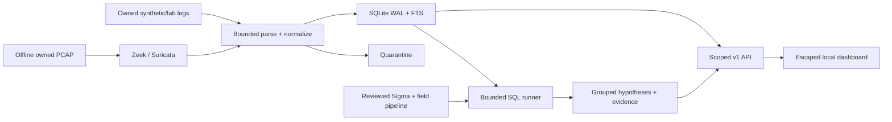

# minisiem

A defensive local Mini-SIEM: collect bounded log records, normalize them into UTC events,
search SQLite WAL/FTS5, compile Sigma rules into parameterized SQLite queries, and review
grouped alert hypotheses with evidence in a scoped API and escaped dashboard.

**Use synthetic data, reviewed public datasets, or your isolated lab only.** Never ingest
home, workplace or other people's logs. Monitoring without ownership/authorization may
violate privacy/interception laws; this is general information, not legal advice. Read
[SAFETY.md](SAFETY.md). No live capture, packet transmission, offensive simulation, external
webhooks, ML, clustering or user-management system is included.

The three implementation milestones are present in this checkout. External validation
is explicitly outstanding: public event-level precision/FPR cannot be inferred from the reviewed scenario-labeled
Splunk subset; actual i3/8-GB laptop and sustained-writer benchmarks must run on that machine, and hosted
GitHub CI/publication must execute after you push. See [status](docs/status.md); this is a
working portfolio demonstration, not a claim that every requested external check passed.

## Start from the terminal

Python 3.12+, SQLite >=3.38 and Linux/WSL2. Exact dependencies are pinned; no GPU needed.

```bash
python3.12 -m venv .venv
source .venv/bin/activate
python -m pip install -r requirements.lock
python -m pip install --no-build-isolation --no-deps -e .
make check
minisiem keygen
make demo
minisiem serve
```

The listener binds 127.0.0.1:8000. Open it locally on your laptop; the cloud onboarding UI
has no localhost preview. Read the private ignored `.env` locally to enter the key in the
dashboard. Never paste it into chat, command arguments, reports or Git. `keygen` refuses
to overwrite an existing file. API query/alert data and OpenAPI JSON require scoped keys;
the public HTML/static shell contains no telemetry. The worker runs detection/retention
periodically; live processes must be restarted after restoring an environment snapshot.

[Runbook](docs/runbook.md) contains every install, ingest, sensor, jq/SQLite cross-check,
API request, retention, evaluation and reviewed Git commit/push command. [Bundled phase
map](docs/phases.md) covers all 22 requested phases without approval stops. The application
uses consolidated cohesive modules rather than empty per-feature wrappers.

## What is implemented

- Generic JSONL, basic RFC3164/RFC5424, combined web, Zeek conn/dns/http/ssl/notice and
  Suricata alert/flow/dns/http/tls normalization; raw/unmapped data, timestamp warnings,
  quarantine, deterministic deduplication and optional privacy-redacting HMAC mode.
- Batch ingestion with atomic file offsets, renamed-inode drain, truncate/rewrite detection,
  partial-line handling, bounded memory and rate/lag/error metrics. Copytruncate's lost-byte
  race is documented rather than falsely promised solved. Optional HTTP ingest has its own scope.
- Versioned schema, WAL, FTS5, indexes, retention that really deletes FTS/evidence/links,
  bounded structured/FTS search and safe CSV export. User SQL is never accepted.
- Real pySigma custom mapping plus official Windows/Sysmon pipelines. Ten original alerting
  rule files, 25 positive/negative/window/order cases, four native Sigma correlation types,
  bounded micro-batches, durable cursors, timeout isolation, RE2, compile coverage and explicit
  unsupported/not-applicable reasons. Six additional evidence-only documents support correlations.
- Evidence-bearing grouped alerts with severity, ATT&CK metadata, author/license, linked
  sensor context, notes/statuses, justified expiring suppression and local-file notification.
- v1 scoped read/query, alert-write, ingest and admin operations, fixed field projection,
  pagination/time/body/rate limits, OpenAPI JSON, same-origin checks and strict CSP.
- Local-only dashboard overview, search, alert queue/detail/timeline, analyst workflow,
  rule statistics and ingest health; Jinja autoescape and no CDN/inline scripts.
- Seeded synthetic scenarios/ground truth, 10,000 mutated inputs, parsing reference checks,
  source throughput/RSS/file-size/query benchmarks, eight baselines/ablations, ATT&CK
  existence-versus-firing matrix, miss analysis and CSV/JSON/plot outputs.
- Optional local asset, IOC and vulnerability-finding annotation through `minisiem enrich`.
  EVTX, TCP/UDP syslog, DuckDB and AI clients are optional future integrations, not shipped.

## Data flow



Zeek describes flows/protocol behavior; Suricata produces signature hypotheses. Neither
means an intrusion happened. Community ID or tuple/time links their context. Sigma YAML
expresses selections; a processing pipeline maps logsource/field names to this schema;
pySigma compiles SQL; SQLite evaluates bounded queries and returns evidence IDs. Alert
fatigue is central: tune and group weak hypotheses so humans can review them, then measure
benign alert volume and false positives. High recall alone is insufficient.

## Offline sensor workflow

```bash
make sensors
```

This generates an original eight-packet benign HTTP PCAP in ignored data/, then runs pinned
Zeek 8.0.2 and Suricata 8.0.2 one at a time with no network, no capabilities and a 1-GiB
memory cap. The helper uses Docker copy for cloud daemon compatibility and preserves prior
output. Compose profiles `sensors` and `core` are available for local WSL/Linux; core binds
loopback using host networking. Do not run sensors alongside benchmarks. Cap WSL memory
as shown in the runbook. Sensor outputs, databases, upstream rules and PCAPs stay out of Git.

## Measured demonstration

These are cloud-host finite synthetic batches, **not your laptop or sustained live-ingest
performance**. Python 3.12.14, SQLite 3.53.1, 5 visible logical CPUs.
Default performance run ingested 10,000 records per source. Process peak sampled RSS was
49.9 MiB (10-ms sample interval); this does not include Docker or host memory.

| Source | Measured events/s | DB MiB at 10,000 events | Indexed count query median ms |
| --- | ---: | ---: | ---: |
| jsonl | 12453 | 10.60 | 0.014 |
| syslog | 9867 | 9.17 | 0.014 |
| web | 11301 | 10.11 | 0.245 |
| zeek.conn | 6834 | 15.20 | 0.013 |
| suricata | 6156 | 15.20 | 0.014 |

10,000 fixed-seed mutated lines: 1104 accepted, 8896 quarantined,
zero uncaught exceptions; known malformed/oversized quarantine persistence is separately
verified. Reference field extraction agreement was 8/8 against libjq. Actual offline sensors
produced one conn/http flow, one original Suricata signature alert, 8 decoded packets and
0 invalid packets, with equal community IDs. Tiny original sensor fixtures exercise the
end-to-end path in CI without Docker.

Synthetic quality: 30 target scenario instances plus 200 benign records, seed 42. The
benign denominator is one synthetic hour, extrapolated to alerts/day. Precision labels an
alert positive when its evidence intersects synthetic target records; scenario recall also
requires the intended rule. It is not independently adjudicated operational precision.

| Variant | Synthetic precision | Scenario recall | Alerts | Visible after suppression |
| --- | ---: | ---: | ---: | ---: |
| full | 1.00 | 1.00 | 39 | 39 |
| without_correlation | 1.00 | 0.60 | 27 | 27 |
| suricata_only | 1.00 | 0.10 | 6 | 6 |
| keyword | 1.00 | 0.50 | 15 | 15 |
| group_60s | 1.00 | 1.00 | 42 | 42 |
| group_900s | 1.00 | 1.00 | 39 | 39 |
| without_linking | 1.00 | 1.00 | 39 | 39 |
| with_suppression | 1.00 | 1.00 | 39 | 30 |

Full-run ingest-to-alert latency p50/p95: 100.4/103.1 ms on this finite
synthetic workload. This is not a sustained log-write-to-alert latency distribution.
All variants observed zero false-positive alerts on this small toy benign sample; that
cannot establish an operational false-positive rate. Grouping controls volume, suppression
controls visibility, and linking adds context rather than changing decisions. Size per
million in JSON is extrapolated from 10,000 unless you explicitly run a million.

```bash
MPLCONFIGDIR=/tmp/minisiem-mpl minisiem evaluate --events 10000
jq '.fuzzing, .detection[0].per_rule' results/results.json
```

CSV/JSON, saved config, ATT&CK matrix, every ablation miss and plot are in ignored results/.
The [evaluation notes](eval/README.md) define metrics and limitations. The source generation
and seed are retained; timings vary with host load. The reviewed public lab evaluation recovered both technique-labeled scenarios, but
event-level public precision/FPR and actual laptop evaluation remain unavailable. SigmaHQ/benign toy datasets understate real-world false positives,
synthetic scenarios are easier than real data, and rule coverage is not detection ability.

## Validation and attribution

Ruff, formatting, mypy, pytest, original rule cases, package dependency consistency,
Docker build and offline Docker rule cases were run locally. Hosted Actions has not run;
the CI check stage disables outbound networking and never invokes Docker/downloads. Its
setup/action/dependency provisioning necessarily uses the network.

Read [licenses](docs/licenses.md): SigmaHQ DRL-1.1 requires rule-author attribution in match
outputs; pySigma/Sysmon/Windows are LGPL-2.1, and the pinned SQLite backend is LGPL-3.0-only.
Zeek is BSD-style; Suricata is GPL-2.0 and runs as a separate executable. Original Suricata
signature/rules/fixtures are MIT. Only two upstream Windows rules were compiled in the
ignored subset; no upstream detection-accuracy claim is made. Packaging/redistribution
must preserve applicable notices and copyleft obligations. No public dataset is bundled; the reviewed Apache-2.0 Splunk subset is an optional
checksum-verified download.

More documentation: [SIEM primer](docs/how_a_siem_works.md), [schema/time/search](docs/schema.md),
[detection engineering](docs/detection_engineering.md), [API contract](docs/api.md),
[dataset admission](docs/datasets.md), [safety](SAFETY.md), [completion status](docs/status.md).


## Public lab dataset (reviewed and run)

`minisiem evaluate-public` downloads and verifies three tiny Sysmon XML exports from
[Splunk attack_data](https://github.com/splunk/attack_data) at the pinned revision in
configs/public_dataset.json, under Apache-2.0. The upstream metadata identifies lab
provenance and T1059.001 scenario labels. Eight input records normalized without errors;
the existing PowerShell hypothesis fired in both labeled scenarios (2/2). Overlapping
records were deduplicated and replay was verified.

These are technique/scenario labels, so event precision, false-positive alerts/day and
real-time detection delay are null/unavailable, not reported as perfect. A broad PowerShell
signal is not proof that a command was malicious. [Review, exact counts, terms and
reproduction](docs/public_dataset.md). All public logs remain ignored and CI uses only
original synthetic XML fixtures. `minisiem evaluate-public --offline` reuses the verified
cache; the normal synthetic evaluation/test commands never fetch public data.
