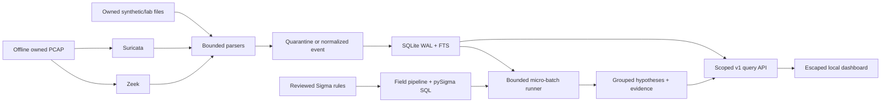

# Follow one event

Raw synthetic RFC5424 input:

```text
<34>1 2025-01-01T00:00:00Z synthetic-lab sshd 1 ID - Failed password for synthetic-alice
```

1. Collect: the file reader sees a complete UTF-8 line. It reads at most one bounded batch.
2. Parse: the syslog parser extracts a timestamp, host, app and message. Its basic classifier
   labels `action=ssh_login`, `outcome=failure`. That classification is intentionally simple,
   so a real logsource adapter would need independent validation.
3. Normalize: UTC timestamp, original spelling and timezone, `dataset=syslog`, source identity,
   host, clean message, raw record and all unmapped fields become one Pydantic event.
   SHA256(source + NUL + exact raw record) is its stable replay identity.
4. Store: SQLite inserts it and its FTS message, then commits the file offset in the same
   transaction. A crash cannot commit the checkpoint without the corresponding events.
5. Detect: an original Sigma rule selects failures. Its processing pipeline maps Sigma names
   onto fixed SQLite columns and constrains the logsource's dataset. pySigma produces SQL;
   Mini-SIEM binds its literals and evaluates it in a time/row-limited read context.
6. Alert: one failure is a low-confidence hypothesis. Three failures from the same source
   within two minutes also satisfy the burst correlation. The backend returns contributing
   event IDs. The alert groups rule + host + five-minute anchor window, with unique evidence,
   author, level and ATT&CK tags. The analyst reviews and records a disposition.

Zeek describes protocol and flow behavior: conn/dns/http/ssl/notice. Suricata inspects
traffic using signatures and emits EVE alert/flow/dns/http/tls records. Offline sensors
read the same owned PCAP without a network. Community ID hashes a canonical flow tuple;
both pinned tools use seed 0. A tuple plus time-window fallback links missing IDs.



Alert fatigue is central: a technically correct rule can create too many weak hypotheses.
Count unique evidence, group repeats, measure benign alerts/day, and tune using recorded
justifications. High synthetic recall is insufficient if humans cannot review the queue.
